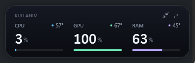
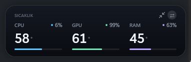
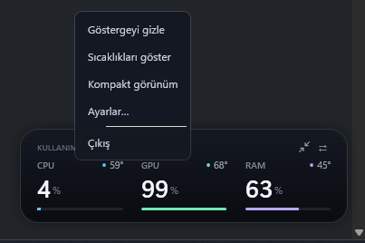
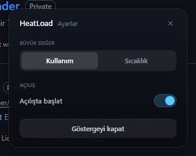
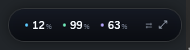

# HeatLoad

[English](README.md) · **Türkçe**

Windows için, saatin hemen üstünde duran küçük bir masaüstü widget'ı: **CPU, GPU ve RAM kullanımı ile sıcaklıklarını** canlı gösterir. Pencere çerçevesi yok, görev çubuğu düğmesi yok — sadece koyu cam görünümlü bir kart ve bir tepsi simgesi.

**[HeatLoad-Setup.exe indir](https://github.com/akupelikilinc/HeatLoad/releases/latest)** — Windows 10/11, 51 MB, .NET çalışma zamanı gerekmez.

<p>
  
</p>

## Özellikler

- **Saniyede bir canlı veri** — CPU, GPU ve RAM kullanımı; CPU, GPU ve RAM sıcaklıkları.
- **Tek tıkla iki görünüm** — ⇄ okuyla kullanım ile sıcaklık arasında geçiş. Büyük değer seçili görünümü izler, köşedeki rozet diğerini göstermeye devam eder.
- **Sessiz kalmak istediğinde kompakt** — okun yanındaki ⤡ ikonu kartı yalnızca üç sayıdan (renk kodlu) oluşan ince bir şeride indirir; ⤢ tam kartı geri getirir. Seçim hatırlanır.
- **Köşe için tasarlandı** — çerçevesiz, her zaman üstte, odağı çalmaz, görev çubuğunda yer kaplamaz. İstediğin yere sürükleyebilirsin; bıraktığın yeri hatırlar.
- **Tepside yaşar** — sol tık göstergeyi açar/kapatır, sağ tık menüyü açar.
- **Her yerde aynı menü** — göstergede veya tepsi simgesinde sağ tık: gizle/göster, görünüm değiştir, ayarlar, çıkış.
- **Windows ile başlar** — en yüksek yetkili zamanlanmış görev sayesinde açılışta UAC sormadan, sıcaklıklar çalışır hâlde başlar.
- **Ağ yok, telemetri yok** — tüm değerler yerelde Win32, NVML ve LibreHardwareMonitor ile okunur.

## Ekran görüntüleri

**Sıcaklık görünümü** — aynı kart, sıcak değer büyür, yük köşede kalır.



**Sağ tık menüsü** — göstergede ve tepsi simgesinde aynı.



**Ayarlar** — varsayılan görünüm, açılışta başlat, göstergeyi kapat.



**Kompakt görünüm** — ⤡ ikonu kartı yalnızca üç sayıdan oluşan ince bir şeride indirir.



Her sürümün değişiklikleri ve görselleri: **[CHANGELOG.md](CHANGELOG.md)**.

## Gereksinimler

- Windows 10 veya 11, 64 bit
- [.NET 10 SDK](https://dotnet.microsoft.com/download) — yalnızca kaynaktan kurulumda gerekir; Setup.exe kendinden içerikli
- Yönetici yetkisi — Windows, CPU ve anakart sıcaklık sensörlerini normal süreçlere açmaz
- [PawnIO](https://pawnio.eu/) — LibreHardwareMonitor'ün yeni AMD işlemcilerde sensör okumak için kullandığı düşük seviyeli sürücü (bir kez kurulur, tek UAC onayı ister)
- NVIDIA ekran kartı sıcaklığı NVML'den gelir; güncel bir GeForce sürücüsü yeterlidir (AMD ekran kartı sıcaklığı henüz okunmuyor)

## Kurulum

### Setup.exe (SDK gerekmez)

**[HeatLoad-Setup-1.1.0.exe](https://github.com/akupelikilinc/HeatLoad/releases/latest)** dosyasını indirip çalıştırın. 51 MB'lık kendinden içerikli kurulum paketi — .NET çalışma zamanı, PowerShell betiği veya SDK gerekmez.

`C:\Program Files\HeatLoad` altına kurar, açılış görevini oluşturur, başlat menüsüne kısayol ekler ve *Uygulamalar ve özellikler* listesine yazılır. Tek ek gereksinim PawnIO (bkz. Gereksinimler).

> Kurulum paketi kod imzalı olmadığı için SmartScreen uyarabilir: *Daha fazla bilgi* → *Yine de çalıştır*.

### Kaynaktan

Depoyu klonlayın ve kurulum betiğini çalıştırın. Uygulamayı derler, `C:\Program Files\HeatLoad` altına kopyalar ve açılış görevini ekler.

```powershell
git clone https://github.com/akupelikilinc/HeatLoad.git
cd HeatLoad
powershell -ExecutionPolicy Bypass -File .\install.ps1
```

Betik kendini yönetici olarak yükseltir, projeyi yayımlar, **HeatLoad** adlı zamanlanmış görevi (`Oturum açılışında`, `En yüksek ayrıcalıklarla çalıştır`) oluşturur ve başlatır. Bir sonraki oturum açılışından itibaren gösterge UAC sormadan kendiliğinden gelir.

> `dotnet` komutunun `PATH` üzerinde olması gerekir. Yoksa önce .NET 10 SDK'yı kurun.

### Kurmadan çalıştırma

Geliştirirken işe yarar — zamanlanmış görev oluşturmadan derleme çıktısından çalıştırır:

```powershell
dotnet run --project .\HeatLoad
```

Yönetici yetkisi olmadan da açılır, ancak sıcaklıklar `0` görünür.

### Kaldırma

Setup.exe ile kurduysanız *Ayarlar → Uygulamalar → Yüklü uygulamalar → HeatLoad* üzerinden kaldırın. Kurulum betiğiyle kurduysanız:

```powershell
powershell -ExecutionPolicy Bypass -File .\uninstall.ps1
```

Uygulamayı durdurur, zamanlanmış görevi, `C:\Program Files\HeatLoad` klasörünü ve `HKCU\Software\HeatLoad` ayar anahtarını siler. PawnIO sürücüsüne dokunmaz — gerekmiyorsa *Uygulamalar ve özellikler*'den kaldırabilirsiniz.

## Kullanım

| Eylem | Sonuç |
|:--|:--|
| Karttaki ⇄ | Büyük değeri kullanım ile sıcaklık arasında değiştirir |
| Karttaki ⤡ / ⤢ | Kompakt görünüm (üç sayı) / tam kart — hatırlanır |
| Kartı sürükle | İstediğin yere, istediğin monitöre taşır; bıraktığın yerde kalır |
| Karta sağ tık | Menü: gizle/göster, sıcaklık görünümü, kompakt görünüm, ayarlar, çıkış |
| Tepsi simgesine sol tık | Göstergeyi gösterir veya gizler |
| Tepsi simgesine sağ tık | Aynı menü |
| Windows açılışı | Gösterge kendiliğinden, yönetici olarak gelir |

Gösterge ekran dışına taşınarak gizlenir; görev çubuğunda veya Alt+Tab listesinde iz bırakmaz.

Seçilen görünüm `HKCU\Software\HeatLoad` altında saklanır (`Mode`: `0` = kullanım, `1` = sıcaklık, `Compact`: `0` = tam kart, `1` = kompakt). Kartın konumu da aynı yerde tutulur (`X`, `Y`); kayıtlı konum yoksa saat üstündeki varsayılan yere döner.

### Ayarlar

Menüden **Ayarlar…**:

- **Kullanım / Sıcaklık** — varsayılan görünüm.
- **Açılışta başlat** — açılış görevini açar/kapatır (`schtasks`), hemen etkili olur.
- **Göstergeyi kapat** — göstergeyi gizler, uygulama tepside kalır.

`Esc`, ✕ düğmesi veya dışarıya tıklayarak kapatılır.

### Tepsi simgesi

Windows 11 yeni tepsi simgelerini gizli simgeler panelinde (`^` oku) tutar. HeatLoad simgesini bir kez görev çubuğuna sürükleyin; Windows orada tutar.

## Nasıl çalışır

| Bölüm | Kaynak |
|:--|:--|
| CPU kullanımı | Örnekler arası `GetSystemTimes` farkı |
| RAM kullanımı | `GlobalMemoryStatusEx` |
| GPU kullanımı | NVML (`nvml.dll`) — `nvmlDeviceGetUtilizationRates` |
| CPU sıcaklığı | LibreHardwareMonitor — `Core (Tctl/Tdie)` |
| Anakart / RAM sıcaklığı | LibreHardwareMonitor — DIMM SPD sensörü |
| GPU sıcaklığı | NVML — `nvmlDeviceGetTemperature` |

Her şey arayüz iş parçacığındaki tek bir 1 saniyelik `DispatcherTimer` ile döner; okumalar bloklamayan Win32 çağrıları ve birkaç sürücü sorgusundan oluşur. Uygulama, `WS_EX_TOOLWINDOW | WS_EX_NOACTIVATE` ve en üstte stilli tek bir WPF penceresidir; bu yüzden odağı hiç almaz.

## Sorun giderme

**Sıcaklıklar 0 görünüyor.**
Süreç yönetici değil veya PawnIO kurulu değil. PawnIO'yu kurun, ardından uygulamayı zamanlanmış görevle başlatın (`Start-ScheduledTask -TaskName HeatLoad`) ya da terminali yönetici olarak açın.

**GPU değerleri 0 veya yok.**
NVML yalnızca NVIDIA kartları görür. Sürücünün kurulu olduğunu doğrulayın — `nvidia-smi` kartı listelemeli.

**Tepsi simgesi yok.**
Windows 11 onu gizli simgeler paneline koyar; görev çubuğuna sürükleyin. Orada da yoksa `install.ps1` betiğini tekrar çalıştırın.

**Hiçbir şey görünmüyor.**
`%LOCALAPPDATA%\HeatLoad\error.log` dosyasına bakın. Bu dosya yalnızca çökme durumunda yazılır.

**Kurulumda SmartScreen / antivirüs uyarısı.**
Çalıştırılabilir dosya kod imzalı değil. Kendiniz kaynaktan derleyin veya antivirüsünüzde izin verin.

**Kart yolun üstünde duruyor.**
Sağ tık → *Göstergeyi gizle* veya tepsi simgesine sol tık. Ok ve menü tıklama gerektirdiği için kart tıklamayı geçirmez.

## Proje yapısı

```
HeatLoad/
  App.xaml, App.xaml.cs        Tek örnek, çökme günlüğü, koyu menü stilleri
  MainWindow.xaml(.cs)         Gösterge, tepsi simgesi, menü, görünüm geçişi
  SettingsWindow.xaml(.cs)     Ayarlar kartı
  Collector.cs                 Win32 + NVML + LibreHardwareMonitor okumaları
  Autostart.cs                 schtasks sorgulama/açma/kapatma
  AppSettings.cs               HKCU ayarları
  app.manifest                 requireAdministrator, PerMonitorV2
  app.ico                      Tepsi ve exe simgesi (make-icon.ps1 yeniden üretir)
install.ps1                    Program Files'a yayımla + açılış görevi
uninstall.ps1                  Görevi, dosyaları, ayarları sil
make-icon.ps1                  app.ico yeniden üretimi
installer/HeatLoad.iss         HeatLoad-Setup.exe için Inno Setup betiği
```

## Kurulum paketini üretmek

```powershell
dotnet publish HeatLoad -c Release -r win-x64 --self-contained true -o publish-selfcontained `
  -p:SatelliteResourceLanguages=en -p:DebugType=None -p:DebugSymbols=false
& "$env:LOCALAPPDATA\Programs\Inno Setup 6\ISCC.exe" installer\HeatLoad.iss
```

Paket `dist\` altında oluşur. Kendinden içerikli yayını (hedef makinede .NET çalışma zamanı gerekmez), açılış görevini ve kaldırıcıyı içerir.

## Lisans

[MIT](LICENSE)
